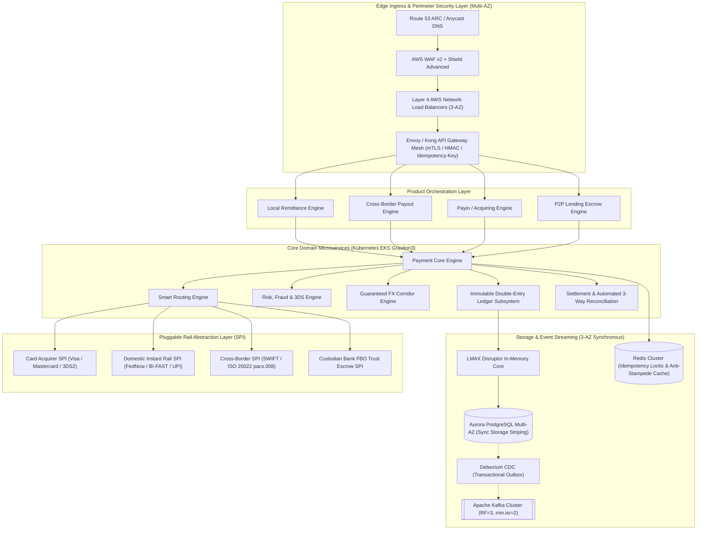

# Next-Generation Payment Gateway Platform

[](https://github.com/jouzu1/payment-gateway-platform/actions/workflows/lint.yml)
[](#architecture)
[](#system-sla-targets)
[](#system-sla-targets)
[](#cloud-finops--tco-summary)
[](LICENSE)

An enterprise-grade, high-availability, low-latency, and cost-efficient financial transaction processing platform. Built for global payment acquiring (Payin), domestic instant remittance (Local Payout), cross-border multi-currency remittance (FX Payout), and P2P lending regulatory escrow operations.

---

## 1. Architectural Highlights

- **Zero Single Point of Failure (Zero-SPOF)**: Multi-AZ 3-AZ Active-Active in-region architecture ($\text{RPO}=0$, $\text{RTO}<3\text{s}$) paired with Cross-Region Warm Standby Disaster Recovery via AWS Route 53 ARC ($\text{RPO}\le 1\text{s}$, $\text{RTO}<30\text{s}$).
- **Ultra-Low Latency & High Concurrency**: Lock-free single-writer partitioned actor architecture inspired by the LMAX Disruptor ($>100\text{k TPS/core}$), achieving baseline latencies of $p50 < 20\text{ms}$, $p95 < 50\text{ms}$, and $p99 < 100\text{ms}$ at $10,000+\text{ TPS}$.
- **Immutable Double-Entry Ledger**: Mathematical balance invariant enforcement ($Assets = Liabilities + Equity$) using 64-bit integer minor units, append-only journal entries, and tamper-evident SHA-256 hash chaining.
- **Distributed Idempotency & Sagas**: Atomic reservations using Redis `SETNX` with payload hashing, combined with the Transactional Outbox pattern and Debezium Change Data Capture (CDC) streaming to Apache Kafka.
- **Automated 3-Way Reconciliation**: Automated matching across internal double-entry ledgers, gateway logs, and ISO 20022 (`camt.053`), SWIFT (`MT940`), BAI2, and NACHA bank clearing files.
- **Cloud FinOps Optimization**: Bin-packed Kubernetes EKS deployment on AWS Graviton3 (ARM64) with Karpenter autoscaling, yielding a **91.92% TCO cost reduction** over serverless Lambda architectures.

---

## 2. System Topology & Architecture



---

## 3. Product Workflows Matrix

| Product Rail | Target Use Cases | Primary Clearing Protocols | Core Invariants & Features |
| :--- | :--- | :--- | :--- |
| **Local Remittance (Payout)** | Instant bank transfers, payroll, merchant settlements | Domestic RTGS, FedNow, BI-FAST, UPI, Faster Payments | Real-time beneficiary account inquiry, batch clearing window cutoff fallback, atomic ledger reservation. |
| **Cross-Border Remittance** | International vendor payouts, multi-currency remittances | SWIFT Alliance Lite2, ISO 20022 (`pacs.008`), FX Brokers | Guaranteed FX rate locking (60s TTL), nostro/vostro liquidity validation, purpose code validation. |
| **Payin / Acquiring** | E-commerce checkout, in-app payments, QR payments | EMV 3DS2 (Frictionless / Challenge), Dynamic QRIS, Direct Debit | Multi-tender checkout sessions, tokenized card vaulting, automatic webhook notifications. |
| **P2P Lending Escrow** | Loan origination, borrower disbursement, repayments | Tripartite FBO Escrow, Auto-Debit, NACHA | POJK 10/2022 regulatory trust account isolation, zero balance pooling, mathematical waterfall split engine. |

---

## 4. System SLA Targets

| Metric | Target SLA | Exceptional (p99 Goal) | Verification Method |
| :--- | :--- | :--- | :--- |
| **Service Availability** | $99.999\%$ (Five Nines) | $99.999\%$ | Multi-AZ 3-AZ Active-Active + Route 53 ARC |
| **In-Region RPO** | $\text{RPO} = 0$ | $\text{RPO} = 0$ | Aurora synchronous 6-way storage striping |
| **In-Region RTO** | $\text{RTO} < 3\text{ seconds}$ | $< 1\text{ second}$ | Sub-second Aurora & Redis leader election |
| **Cross-Region DR RPO** | $\text{RPO} \le 1\text{ second}$ | $< 500\text{ms}$ | Asynchronous Aurora Global DB & MirrorMaker 2 |
| **Cross-Region DR RTO** | $\text{RTO} < 30\text{ seconds}$ | $< 15\text{ seconds}$ | Automated Route 53 ARC control plane cutover |
| **End-to-End p50 Latency**| $< 20\text{ms}$ | $< 12\text{ms}$ | OpenTelemetry & Prometheus histograms |
| **End-to-End p95 Latency**| $< 50\text{ms}$ | $< 35\text{ms}$ | LMAX Disruptor lock-free balance actor |
| **End-to-End p99 Latency**| $< 100\text{ms}$ | $< 65\text{ms}$ | Multi-tier caching with XFetch anti-stampede |
| **Peak Throughput** | $10,000+\text{ TPS}$ | $15,000\text{ TPS}$ | Karpenter Graviton node autoscaling |

---

## 5. Cloud FinOps & TCO Summary

At an enterprise volume of **$7.776\text{ billion}$ transactions per month** ($3,000\text{ avg TPS}$, $10,000\text{ peak TPS}$):

| Cost Category | Model A: Serverless (Lambda + API GW) | Model B: EKS Graviton3 + Karpenter | Monthly Savings ($) | Savings (%) |
| :--- | :--- | :--- | :--- | :--- |
| **Compute Execution** | $\$5,702.42$ | $\$946.08$ | $\$4,756.34$ | $83.4\%$ |
| **API Ingress** | $\$7,028.40$ (HTTP APIs) | $\$65.00$ (AWS NLB) | $\$6,963.40$ | $99.1\%$ |
| **Provisioned Concurrency** | $\$21,900.00$ (Eliminate Cold Starts) | $\$0.00$ (Always Hot) | $\$21,900.00$ | $100.0\%$ |
| **Full-Stack Blended Spend** | **$\$52,000.00\text{ / month}$** | **$\$4,200.00\text{ / month}$** | **$\$47,800.00$** | **$\mathbf{91.92\%}$** |
| **Unit Cost per 100k Txns** | **$\$0.6687$** | **$\$0.0540$** | **$\$0.6147$** | **$\mathbf{91.92\%}$** |

---

## 6. Repository Layout & Architecture Documentation

The specification is structured across 8 authoritative architectural domains:

```text
payment-gateway-platform/
├── .github/workflows/lint.yml             # Automated CI workflow
├── docs/
│   ├── 01-architecture-overview/          # Topology, bounded contexts, extensibility SPI
│   ├── 02-product-workflows/              # Remittance, FX Payout, Payin, P2P Lending
│   ├── 03-core-subsystems/                # Routing, settlement, double-entry ledger, AML
│   ├── 04-data-models-and-schemas/        # ER model, PostgreSQL DDL, API schemas
│   ├── 05-reliability-and-performance/    # HA/DR, LMAX concurrency, idempotency, recon
│   ├── 06-cloud-cost-efficiency/          # FinOps TCO model, compute/storage, network optimization
│   ├── 07-api-and-integration/            # OpenAPI 3.1, gRPC Protobuf, ISO 20022, webhooks
│   └── 08-verification-and-rubric/        # Review rubric, regulatory mapping, verification matrix
├── diagrams/                              # Standalone Mermaid (.mmd) architectural diagrams
├── schemas/                               # Relational DDL (SQL), OpenAPI (YAML), gRPC (Proto)
├── scripts/                               # Schema validator & automated test runner harness
├── tests/e2e/                             # 4-Tier automated test suite (279 test cases)
├── .gitignore                             # Production Git exclusion rules
├── .markdownlint.json                     # Linter configuration
└── README.md                              # Master architectural index
```

---

## 7. Getting Started & Verification

### 7.1 Prerequisites
- Python 3.11+
- Git 2.40+
- (Optional) Node.js 20+ for markdown linting

### 7.2 Run the Automated E2E Verification Harness

The platform includes an automated four-tier verification suite (279 tests) with zero external pip dependencies:

```bash
# Clone the repository
git clone https://github.com/jouzu1/payment-gateway-platform.git
cd payment-gateway-platform

# Run all 4 test tiers (279 tests)
python scripts/run-e2e-tests.py --all

# Run with verbose test method logging
python scripts/run-e2e-tests.py --all --verbose

# Run individual test tiers
python scripts/run-e2e-tests.py --tier 1   # 125 Feature Unit Tests
python scripts/run-e2e-tests.py --tier 2   # 125 Boundary & Negative Edge Case Tests
python scripts/run-e2e-tests.py --tier 3   # 25 Composite Multi-Product Workflows
python scripts/run-e2e-tests.py --tier 4   # 4 Real-World Chaos & Failure Simulations
```

### 7.3 Validate Schemas & Markdown Link Integrity

```bash
python scripts/validate-schemas.py
```
