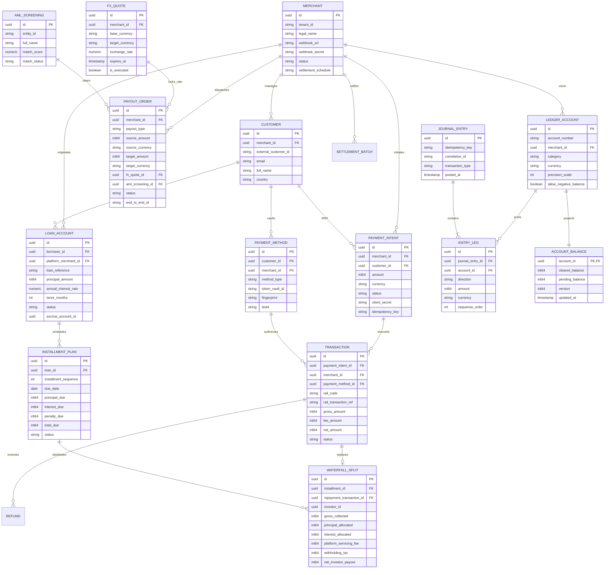

# Entity Descriptions, Relationships & Entity-Relationship (ER) Model

## 1. Data Model Architectural Invariants

The data architecture of the Payment Gateway Platform is designed for strict relational integrity, horizontal scalability, audit compliance, and multi-tenant isolation.

Key design principles:
- **UUIDv7 Primary Keys**: All entity IDs are time-ordered UUIDs (`uuid_generate_v4()` or UUIDv7), preventing B-Tree index fragmentation while enabling distributed client-side ID generation.
- **Strict Foreign Key Constraints with `ON DELETE RESTRICT`**: Financial records cannot be orphaned or cascaded into deletion.
- **Tenant Isolation**: Every query and index is scoped by `tenant_id` and `merchant_id` to enforce strict logical data segregation across tenants.
- **Temporal Versioning & Auditability**: Every mutation updates `updated_at` via timestamp triggers, and financial tables (`journal_entries`, `entry_legs`) are strictly append-only.

---

## 2. Mermaid Entity-Relationship (ER) Diagram

---

## 3. Detailed Entity Catalog & Field Specifications

### 3.1 Merchant Context Entities
- **`Merchant`**: Root multi-tenant entity representing business clients. Defines settlement schedules ($T+0, T+1, T+2$), risk tiers, and webhook cryptographic keys.
- **`Customer`**: End-consumer entity associated with a merchant. Stores vaulted payment methods, KYC tier status, and billing identities.
- **`PaymentMethod`**: Tokenized representation of payment instruments (credit/debit cards, bank accounts, virtual accounts). Raw card data is represented solely by a reference pointer (`token_vault_id`) into the isolated PCI vault.

### 3.2 Acquiring Context Entities
- **`PaymentIntent`**: High-level intent to collect payment. Encapsulates amount, allowed rails, capture mode (Automatic vs Manual), and lifecycle status.
- **`Transaction`**: Physical execution attempt against an external payment rail adapter (e.g. CyberSource, FedNow). Links to raw network response and settlement batch.
- **`Refund`**: Reversal record tied to a settled transaction. Encapsulates partial or full refund amount and rail refund reference.

### 3.3 Remittance & FX Entities
- **`PayoutOrder`**: Instruction to remit funds locally or cross-border. Encapsulates beneficiary account details, ISO 20022 `EndToEndId`, and status.
- **`FXQuote`**: Binding foreign exchange rate agreement locked with a 60-second TTL.
- **`AMLScreening`**: Audit record of fuzzy sanctions and PEP screening executed against international watchlists.

### 3.4 P2P Lending Entities
- **`LoanAccount`**: Lending contract connecting borrower, funding platform, and custodian bank FBO escrow account.
- **`InstallmentPlan`**: Amortization schedule defining monthly principal, interest, overdue penalties, and collection states.
- **`WaterfallSplit`**: Mathematical distribution record documenting the pro-rata allocation of collected repayments to fractional investors, platform fees, and statutory withholding taxes.

### 3.5 Core Ledger Entities
- **`LedgerAccount`**: Standardized Chart of Accounts record (Asset, Liability, Equity, Revenue, Expense) denominated in a specific ISO 4217 currency.
- **`JournalEntry`**: Header record for an atomic double-entry transaction.
- **`EntryLeg`**: Individual debit or credit posting leg linked to a ledger account, stored strictly in positive integer minor currency units.
- **`AccountBalance`**: Atomically updated balance projection storing current cleared and pending balances with monotonic version sequencing.
