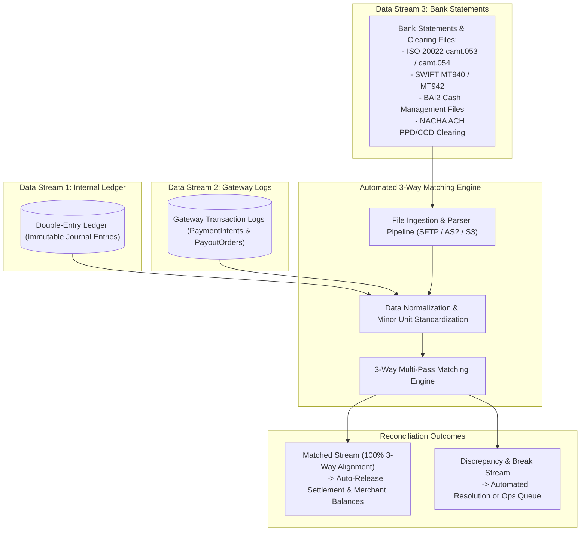
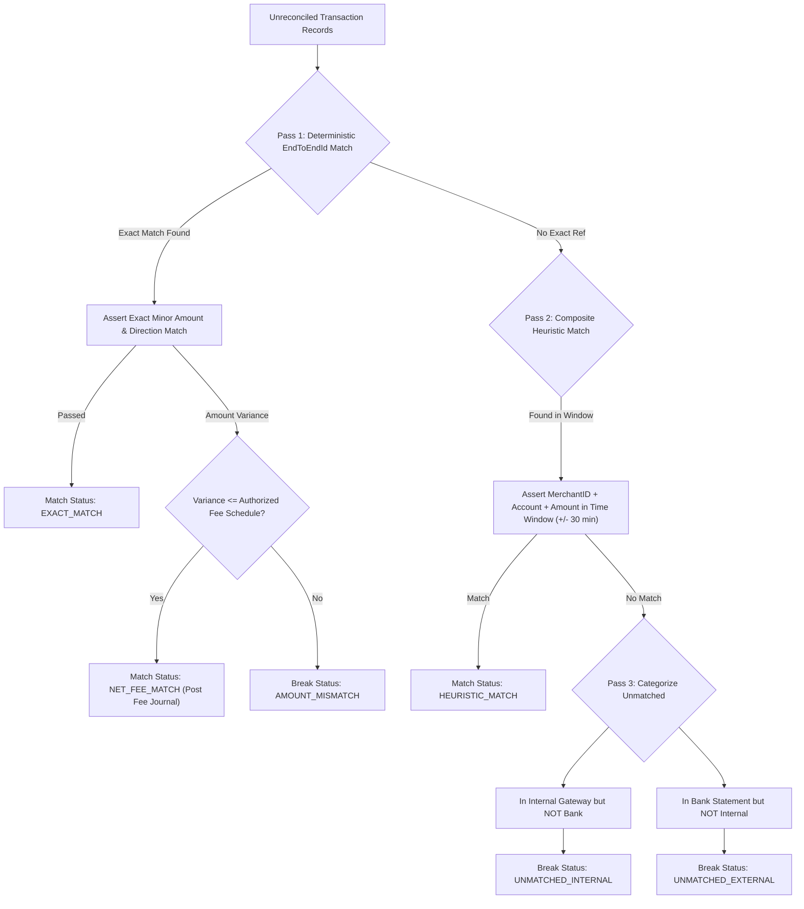

# Automated 3-Way Reconciliation & Break Resolution Engine

## 1. Executive Summary & Reconciliation Invariants

In modern payment engineering, real-time transaction processing guarantees internal consistency, but financial settlement is finalized through asynchronous clearing cycles with banking networks and card schemes. 

Discrepancies inevitably arise from:
- Network packet drops during bank acknowledgment callbacks.
- Batch cut-off window misalignments (e.g., transactions submitted at 23:59:58 settled on the following banking business day).
- Undocumented intermediary bank wire fees and interchange deductions.
- Chargebacks, refunds, and reversal races.

The platform implements an **Automated 3-Way Reconciliation Engine** that executes end-of-day (EOD) and intraday settlement matching across three authoritative data streams, ensuring zero balance leakage and deterministic break resolution.

---

## 2. Three-Way Reconciliation Architecture



### 2.1 The Three Authoritative Streams

1. **Internal Double-Entry Ledger**:
   - Represents the accounting truth ($Assets = Liabilities + Equity$).
   - Records every debit and credit leg with monotonic sequencing and minor currency unit amounts.
2. **Gateway Transaction Processing Log**:
   - Represents the operational lifecycle (intent creation, 3DS challenge, customer metadata, processor attempts, routing decisions).
3. **External Bank Clearing Statements**:
   - Represents external banking reality: money received into Nostro accounts or cleared through central clearing switches.

---

## 3. Bank Statement Ingestion & Parsing Specifications

The engine supports native streaming and batch parsers for all standard global banking formats:

### 3.1 ISO 20022 `camt.053` (Bank-to-Customer Statement)
The gold standard for modern XML-based banking statements.
- **Root Element**: `<Document><BkToCstmrStmt>`
- **Statement Header**: `<Stmt><Id>`, `<ElctrncSeqNb>`
- **Entry Details**:
  - `<Ntry><Amt Ccy="USD">5000.00</Amt>` (Parsed to integer `500000` minor units)
  - `<CdtDbtInd>`: `CRDT` (Cash Inflow) or `DBIT` (Cash Outflow)
  - `<NtryDtls><TxDtls><Refs><EndToEndId>`: Maps directly to internal `payment_intent_id` or `payout_order_id`.

### 3.2 SWIFT `MT940` (Customer Statement Message)
Legacy fixed-format banking statement used across international correspondent networks:
- **Tag `:20:`**: Transaction Reference Number.
- **Tag `:25:`**: Account Identification.
- **Tag `:28C:`**: Statement Number / Sequence.
- **Tag `:60F:`**: Opening Balance.
- **Tag `:61:`**: Statement Line:
  ```text
  :61:2611101110CD10000,00NTRFREF10029348//NONREF
  ```
  *(Format: `YYMMDD` Value Date + `MMDD` Entry Date + `D/C` Indicator + Amount + Transaction Type + Reference)*
- **Tag `:86:`**: Information to Account Owner (Contains remittance narrative and merchant ID).

### 3.3 BAI2 (Bank Administration Institute v2)
Specialized cash management file format used predominantly in North American commercial banking:
- **Record `01`**: File Header.
- **Record `02`**: Group Header.
- **Record `03`**: Account Identifier & Summary.
- **Record `16`**: Transaction Detail Record:
  ```text
  16,175,1000000,Z,000000000,REF_PAYOUT_88192,/
  ```
  *(Format: Type Code `175` = Commercial Deposit, Amount in cents, Funds Type, Bank Reference, Customer Reference)*
- **Record `49`**: Group Trailer.
- **Record `99`**: File Trailer.

### 3.4 NACHA (Automated Clearing House - ACH)
Batch payment format used in US domestic ACH processing:
- File Header (`1`), Batch Header (`5`), Entry Detail (`6` - PPD/CCD), Addenda (`7`), Batch Control (`8`), File Control (`9`).

---

## 4. Multi-Pass Matching Algorithm & Rules

The reconciliation engine processes raw records through a three-stage cascading pipeline:



### 4.1 Pass 1: Deterministic End-to-End Reference Match
- Compares `EndToEndId` (ISO 20022), Customer Reference (BAI2), or Tag 61 Reference (MT940) against internal `transaction_id`.
- If a match is found and both currency, direction (`DEBIT`/`CREDIT`), and minor amount are identical, the record is flagged as `EXACT_MATCH`.

### 4.2 Pass 2: Heuristic Windowed Composite Match
If the external bank stripped the reference number (common in legacy domestic clearing networks):
- **Matching Key**: Composite key consisting of:
  $$\text{CompositeKey} = \text{Hash}(\text{BankCode} + \text{TargetAccountNumber} + \text{MinorAmount})$$
- **Time Window**: Evaluated against internal transactions posted within a configurable window ($\pm 30\text{ minutes}$ of statement timestamp).
- When a unique singular candidate is identified, it is flagged as `HEURISTIC_MATCH` and passed for settlement.

### 4.3 Fee Variance Tolerances & Interchange Deduction Isolation
External acquirers often deduct interchange or switch fees at the source before depositing net funds into the platform's Nostro account:
- **Expected Gross Amount**: \$100.00 (`10000` cents)
- **Received Net Settlement**: \$98.20 (`9820` cents)
- **Fee Difference**: \$1.80 (`180` cents)

If the difference matches the pre-negotiated fee rule ($\text{Interchange} = 1.5\% + \$0.30$), the engine automatically constructs a compensatory balancing journal leg:
1. Credit `110100 - Cash & Bank Nostro` with received amount (`+9820`).
2. Debit `510000 - Partner Bank Switch Costs` with interchange fee (`+180`).
3. Settle `120000 - Funds in Transit` with gross amount (`-10000`).

---

## 5. Break Categorization & Exception Management Matrix

When records fail automated matching, they are classified into discrete operational queues:

| Break Category | Root Cause | System Risk | Automated Remediation | Escalation / SLA |
| :--- | :--- | :--- | :--- | :--- |
| **`UNMATCHED_INTERNAL`** | Gateway processed payment; bank dropped transaction or clearing was delayed. | Capital loss if merchant released goods without clearing. | 1. Execute automated bank status inquiry query.<br>2. Check subsequent cut-off window. | If unresolved after 24h, alert Treasury Ops. |
| **`UNMATCHED_EXTERNAL`** | Direct bank wire or unexpected fee refund deposited into Nostro without matching intent. | Unallocated cash sitting in platform accounts. | 1. Parse narrative for merchant tax ID or account.<br>2. Park in Suspense Account (`240900 - Unidentified Receipts`). | Operations investigation queue (48h SLA). |
| **`AMOUNT_MISMATCH`** | FX currency conversion spread drift or unauthorized partner fee deduction. | Balance leakage; ledger imbalance. | If variance $\le \$2.00$, route to Fee Variance Tolerance rule. | If variance $> \$2.00$, freeze settlement and flag for audit. |
| **`TIMING_DELAY`** | Transaction initiated near 23:59:00 cut-off; cleared on following banking day. | False positive alert. | Automated carry-forward to $T+1$ reconciliation cycle. | Auto-cleared in next cycle; zero human intervention. |

---

## 6. End-of-Day (EOD) Sign-Off & Audit Workflow

At the close of each banking business day ($00:00:00\text{ UTC}$ or local market cut-off):
1. **Automated Balance Attestation**:
   The engine computes the total net change across all bank statements and asserts parity against the double-entry ledger's cash movement:
   $$\Delta \text{BankStatementCash} \equiv \Delta \text{LedgerNostroBalance}$$
2. **Reconciliation Sign-Off Certificate**:
   A cryptographic proof (SHA-256 hash of all reconciled entry IDs, total credits, total debits, and remaining break counts) is generated and stored in the audit archive:
   ```json
   {
     "recon_date": "2026-11-10",
     "currency": "USD",
     "total_records_processed": 1450280,
     "exact_match_count": 1449890,
     "heuristic_match_count": 350,
     "breaks_count": 40,
     "net_cleared_volume_cents": 12849201940,
     "status": "APPROVED",
     "sign_off_hash": "a4b8c9d0e1f2a3b4c5d6e7f8a9b0c1d2e3f4a5b6c7d8e9f0a1b2c3d4e5f6a7b8"
   }
   ```
3. **Automatic Settlement Release**:
   Upon positive EOD sign-off, pending merchant balances are transitioned to `cleared_balance`, enabling automated payout batching.
