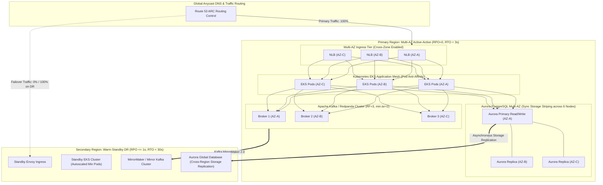
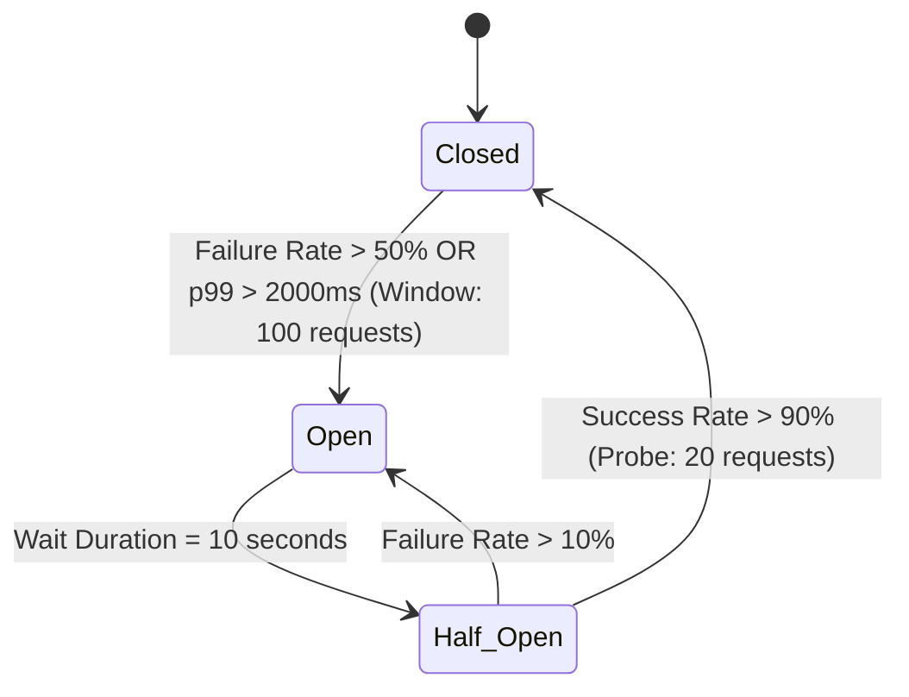
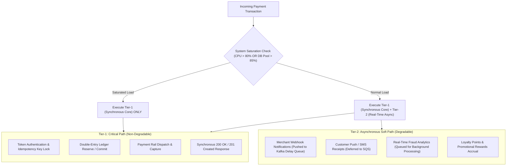
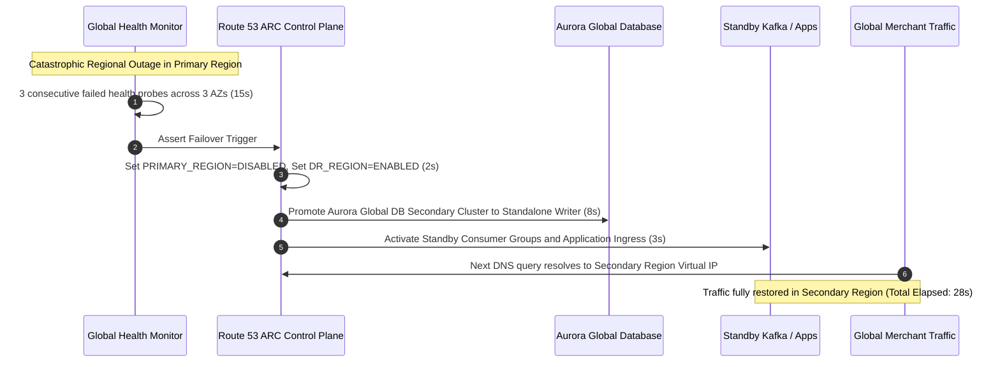

# High Availability (HA) & Disaster Recovery (DR) Architecture

## 1. Executive Summary & Reliability Invariants

The Payment Gateway Platform provides mission-critical financial rails requiring continuous, deterministic operation. Financial regulations (PCI-DSS v4.0 §12.10, ISO 20022 clearing guidelines, and central bank operational resilience standards) strictly dictate zero tolerance for uncommitted data loss and minimal service interruption.

The platform enforces the following recovery metrics:
- **In-Region Multi-AZ Active-Active**:
  - **Recovery Point Objective (RPO)**: $\text{RPO} = 0$ (Zero committed transaction loss).
  - **Recovery Time Objective (RTO)**: $\text{RTO} < 3\text{ seconds}$ (Automated sub-second health-check failover and database leader election).
- **Cross-Region Warm Standby Disaster Recovery (DR)**:
  - **Recovery Point Objective (RPO)**: $\text{RPO} \le 1\text{ second}$ (Continuous asynchronous database WAL shipping and Kafka MirrorMaker / Redpanda topic replication).
  - **Recovery Time Objective (RTO)**: $\text{RTO} < 30\text{ seconds}$ (Automated control-plane traffic cutover via AWS Route 53 Application Recovery Controller).

---

## 2. Multi-AZ Active-Active & Cross-Region DR Topology

The core deployment spans three independent Availability Zones (`AZ-A`, `AZ-B`, `AZ-C`) within the primary metropolitan region (e.g., `ap-southeast-1`), with an asynchronous warm standby deployed in a secondary geographic region (e.g., `ap-southeast-3`).



### 2.1 Topology Comparison & Trade-Off Matrix

| Dimension | Multi-AZ Active-Active (In-Region) | Multi-Region Active-Active | Multi-Region Active-Passive (Warm Standby) |
| :--- | :--- | :--- | :--- |
| **Traffic Distribution** | 100% active across 3 AZs (33.3% per AZ) | 50% / 50% split across regions | 100% Primary, 0% Secondary (Hot sync) |
| **Write Latency** | $< 2\text{ms}$ (Intra-region fiber link) | $70\text{ms} - 150\text{ms}$ (Cross-region 2PC / Paxos) | $< 2\text{ms}$ (Committed locally in Primary) |
| **Data Consistency** | Strict Serializability / Linearizability | Eventual or High-Latency Paxos | Strict ACID in Primary; Async DR replica |
| **RPO (Data Loss)** | **$\text{RPO} = 0$** | $\text{RPO} = 0$ | **$\text{RPO} \le 1\text{s}$** |
| **RTO (Failover)** | **$\text{RTO} < 3\text{s}$** (Automatic local failover) | Instantaneous | **$\text{RTO} < 30\text{s}$** (Route 53 ARC health-check) |
| **Cost Overhead** | Baseline redundant infrastructure ($1.0\times$) | Very High ($2.5\times$ to $3.0\times$ idle capacity) | Moderate ($1.25\times$ baseline infrastructure) |
| **Architectural Verdict** | **MANDATORY for Core Ledger** | **REJECTED** (Violates $p95 < 50\text{ms}$ SLA) | **RECOMMENDED for Disaster Recovery** |

---

## 3. Zero Single Point of Failure (SPOF) Layer-by-Layer Matrix

To eliminate any single component from causing catastrophic outage, every layer is architected with complete redundancy and automated failover.

| Infrastructure Tier | Component | Redundancy Mechanism | Failure Scenario & Mitigation | Automated RTO |
| :--- | :--- | :--- | :--- | :--- |
| **Physical & Network** | Partner Bank Direct Connect | Dual 10Gbps AWS Direct Connect links at separate locations (Equinix + Global Switch) | Primary physical fiber cut $\rightarrow$ BGP routes failover automatically to secondary link within 500ms; IPSec VPN backup. | $< 1\text{s}$ |
| **Egress Gateway** | AWS NAT Gateways | Dedicated NAT Gateway provisioned per AZ (`NAT-GW-A`, `NAT-GW-B`, `NAT-GW-C`) | Outage in `AZ-A` NAT Gateway isolates only outbound traffic originating from `AZ-A`; `AZ-B` and `AZ-C` remain 100% functional. | $0\text{s}$ (Blast radius contained) |
| **Perimeter Ingress** | AWS Network Load Balancer | L4 NLB striped across 3 AZs with cross-zone load balancing enabled | Loss of single AZ NLB node $\rightarrow$ DNS health checks route all ingress to surviving 2 AZ nodes. | $< 2\text{s}$ |
| **API Gateway** | Envoy / Kong Ingress | Kubernetes Deployment with Pod Anti-Affinity and PodDisruptionBudget (`minAvailable: 75%`) | Pod termination or node crash $\rightarrow$ NLB health probe drops unhealthy pod in $< 1\text{s}$; surviving pods absorb traffic. | $< 1\text{s}$ |
| **Compute / Microservices** | Stateless Domain Services | Pods scheduled across 3 AZs via `topologySpreadConstraints` and Karpenter node pools | Node failure or AZ hardware fault $\rightarrow$ Horizontal Pod Autoscaler and Karpenter spin up replacement nodes in surviving AZs. | $< 3\text{s}$ |
| **Relational Database** | AWS Aurora PostgreSQL | Multi-AZ 6-way storage replication across 3 AZs + 2 Read Replicas in distinct AZs | Primary writer instance crash $\rightarrow$ Storage maintains state; Aurora automatically promotes lowest-lag replica to Primary. | $< 15\text{s}$ |
| **Cache Tier** | Redis Cluster | 6-node cluster: 3 Masters, 3 Replicas strictly paired across opposing AZs | Master node failure $\rightarrow$ Surviving master majority elects replica in $< 1\text{s}$; client driver switches connection. | $< 2\text{s}$ |
| **Event Streaming** | Apache Kafka / Redpanda | 3 or 6 brokers striped across 3 AZs; Topics configured with $RF=3, min.isr=2$ | Single broker loss $\rightarrow$ Partition in-sync replica continues writes without blocking; no producer message loss. | $0\text{s}$ (Continuous) |

---

## 4. Resilience Patterns: Circuit Breaking, Bulkheading & Graceful Degradation

### 4.1 Resilience4j & Envoy Circuit Breaker Specification

When upstream clearing networks (e.g., card networks, domestic switches) encounter elevated latencies or packet loss, circuit breakers isolate failing rails before gateway worker thread pools are exhausted.



#### Circuit Breaker Configuration Parameters:
- **Sliding Window Size**: 100 requests (Time-based or count-based evaluation).
- **Failure Rate Threshold**: $\ge 50\%$ HTTP 5xx responses or socket connection timeouts.
- **Slow Call Rate Threshold**: $\ge 5\%$ requests exceeding $2,000\text{ms}$.
- **Wait Duration in Open State**: $10\text{ seconds}$ before permitting probe traffic in Half-Open state.
- **Half-Open Permitted Calls**: 20 requests to test bank rail recovery.
- **Fallback Action**: Instantly route transaction to configured secondary rail (e.g., from primary instant switch to secondary clearing rail) or reject with `503 Service Unavailable` with `Retry-After: 5`.

### 4.2 Bulkheading Architecture

Thread pools, database connection pools, and memory quotas are partitioned strictly by product rail:

```
[ Incoming Requests ]
         |
         +---> Bulkhead Pool 1: Card Acquiring / Payin (Max 150 Connections, Queue 500)
         |
         +---> Bulkhead Pool 2: Local Instant Remittance (Max 100 Connections, Queue 200)
         |
         +---> Bulkhead Pool 3: Cross-Border FX & SWIFT (Max 50 Connections, Queue 100)
         |
         +---> Bulkhead Pool 4: P2P Lending Escrow (Max 50 Connections, Queue 100)
```

**Fault Isolation Invariant**: A catastrophic slow-down in SWIFT correspondent banking APIs cannot consume database connections, memory, or CPU cycles allocated to local Payin or instant remittance rails.

### 4.3 Tiered Graceful Degradation Matrix

Under severe traffic spikes (flash sales, payday disbursements) or degraded infrastructure capacity, non-critical services are shed gracefully to preserve the transactional core:



---

## 5. Automated Disaster Recovery Runbook & Route 53 ARC

### 5.1 Route 53 Application Recovery Controller (ARC) Architecture
AWS Route 53 ARC maintains redundant regional control planes independent of standard AWS management console and regional control planes. Routing controls use atomic boolean flags to steer global Anycast traffic:

```
[ Global Traffic (Route 53 DNS) ]
              |
     [ ARC Routing Control ]
     /                     \
(Flag: PRIMARY=1)       (Flag: SECONDARY=0)
   |                       |
   v                       v
Primary Region (Active)   Secondary Region (Standby)
```

### 5.2 Automated Failover Execution Sequence ($RTO < 30\text{ seconds}$)



---

## 6. Chaos Engineering & Continuous Validation Suite

The platform utilizes **Chaos Mesh** and **AWS Fault Injection Simulator (FIS)** to routinely execute automated disruption scenarios in staging and production canary environments:

1. **Scenario 1: AZ Network Severance (Blackhole)**
   - *Action*: Sever all VPC peering and transit gateway routing to `AZ-B`.
   - *Expected Behavior*: Ingress NLB marks AZ-B unhealthy within 2 seconds. Aurora promotes replica in AZ-C if AZ-B was primary. Kafka partition leaders transfer to AZ-A/AZ-C. Zero data loss ($RPO = 0$). Error rate $< 0.001\%$.
2. **Scenario 2: Partner Bank Clearing Rail Blackhole**
   - *Action*: Inject 100% packet loss on external card network IPs.
   - *Expected Behavior*: Circuit breaker trips from `Closed` to `Open` within 3 seconds ($100$ requests threshold). Smart routing dynamically switches acquiring traffic to backup partner bank.
3. **Scenario 3: Pod Eviction Storm**
   - *Action*: Terminate 50% of stateless payment orchestration pods simultaneously under 5,000 TPS load.
   - *Expected Behavior*: Kubernetes PodDisruptionBudget protects minimum quorum (`minAvailable: 75%`). Karpenter provisions replacement Graviton worker nodes. p99 latency remains $< 100\text{ms}$.
