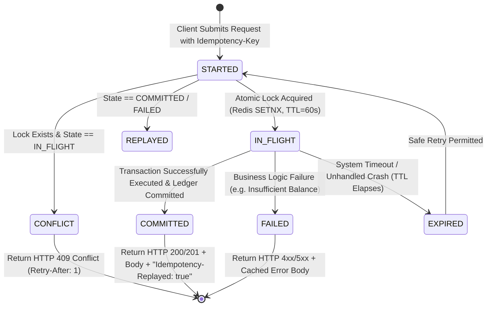
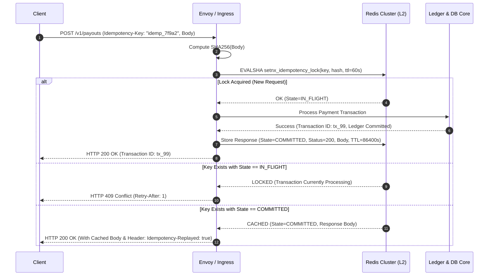
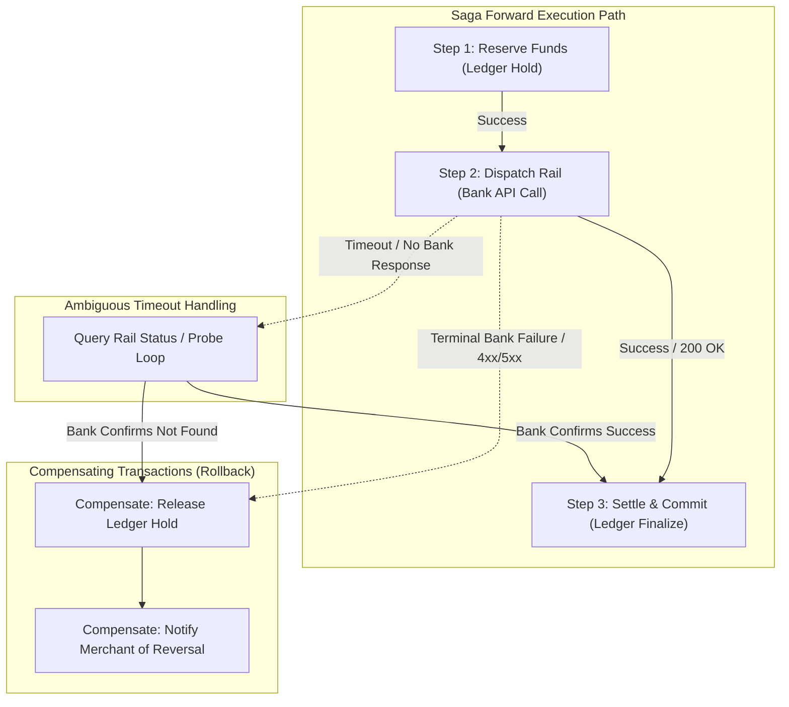
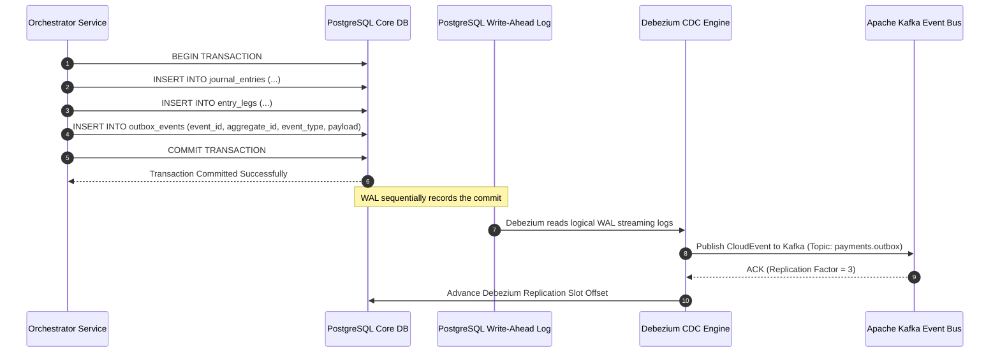

# Distributed Idempotency Framework & Saga Orchestration

## 1. Executive Summary & Problem Formulation

In a distributed financial system, network partitions, client retries, bank timeout cascades, and system crashes inevitably cause duplicate API invocations and partial state mutations. The platform enforces two fundamental distributed systems guarantees:

1. **Distributed Idempotency**: Guaranteeing that repeated submissions of identical transactions produce exactly one state mutation and identical response payloads, eliminating double-charging or double-disbursement risks.
2. **Distributed Transaction Management (Sagas)**: Managing multi-step asynchronous workflows across autonomous banking networks without high-latency, blocking two-phase commit (2PC) protocols.

---

## 2. Distributed Idempotency-Key Framework

### 2.1 Idempotency Key Lifecycle & State Machine

Every mutating request submitted to the platform (`POST /v1/payments`, `POST /v1/payouts`, `POST /v1/lending/disburse`) MUST supply an `Idempotency-Key` HTTP header containing a unique UUIDv4 or client-generated cryptographic token.



### 2.2 Canonical Payload Hashing & Conflict Detection

To prevent clients from accidentally reusing an idempotency key with conflicting transaction parameters, the gateway computes a canonical SHA-256 fingerprint of the request:

$$\text{PayloadHash} = \text{SHA256}(\text{Canonicalize}(\text{HTTP\_Method} + \text{Path} + \text{SortedJSONBody}))$$

- If an incoming request arrives with a matching `Idempotency-Key` but a **different** `PayloadHash`, the gateway immediately rejects the request with `HTTP 422 Unprocessable Entity`:
  ```json
  {
    "type": "https://errors.gateway.io/idempotency-parameter-mismatch",
    "title": "Idempotency Parameter Mismatch",
    "status": 422,
    "detail": "The provided Idempotency-Key was previously used with a different request payload."
  }
  ```

### 2.3 End-to-End Idempotency Sequence



### 2.4 Idempotency Record Storage Schema

```json
{
  "idempotency_key": "idemp_99a8b7c6-d5e4-4f3a-b2c1-0a9b8c7d6e5f",
  "client_id": "client_acme_corp",
  "request_path": "/v1/payouts",
  "request_hash": "e3b0c44298fc1c149afbf4c8996fb92427ae41e4649b934ca495991b7852b855",
  "state": "COMMITTED",
  "status_code": 201,
  "response_headers": {
    "Content-Type": "application/json",
    "Idempotency-Replayed": "true"
  },
  "response_body": {
    "payout_id": "po_8872163901",
    "amount": 2500000,
    "currency": "IDR",
    "status": "SETTLED"
  },
  "created_at": 1794307200,
  "expires_at": 1794393600
}
```

---

## 3. Distributed Transaction Management & Saga Orchestration

### 3.1 Why Two-Phase Commit (2PC) Fails in Payment Gateways

In enterprise finance, operations frequently span multiple autonomous systems: internal double-entry ledgers, external central bank RTGS networks, clearing houses (Visa/Mastercard), and partner bank webhooks.
- **2PC Blocking**: 2PC requires holding distributed locks across all participating systems until the coordinator issues a global commit.
- **External Partner Isolation**: External banking APIs do not expose prepare/commit hooks and cannot participate in XA transactions.
- **Availability Penalty**: Under Brewer's CAP theorem, network latency or partner timeouts hold internal locks, causing system-wide cascading failure.

### 3.2 Orchestrated Saga Pattern with Compensating Transactions

The platform adopts the **Orchestrated Saga Pattern** (powered by Temporal.io or native state-machine orchestrator). The overarching distributed transaction is decomposed into a sequence of local ACID transactions:



### 3.3 Formal State Transition Table

| State | Event Trigger | Next State | Action / Ledger Invariant |
| :--- | :--- | :--- | :--- |
| `INIT` | Transaction received | `HOLD_PENDING` | Begin Saga, evaluate limits and sanctions. |
| `HOLD_PENDING` | Ledger reservation success | `RAIL_DISPATCHED` | Create Pending Hold in double-entry ledger ($Assets = Liabilities$). |
| `HOLD_PENDING` | Ledger reservation failure | `FAILED` | Insufficient funds or account locked; abort immediately. |
| `RAIL_DISPATCHED`| Bank ACK received (Success) | `COMMITTED` | Commit Hold; debit source, credit clearing asset account. |
| `RAIL_DISPATCHED`| Bank NACK / Terminal Failure | `COMPENSATING` | Trigger compensating transaction workflow. |
| `RAIL_DISPATCHED`| Bank Timeout / Socket Error | `AMBIGUOUS_PROBE` | Do NOT compensate; execute automated poll inquiry query. |
| `COMPENSATING` | Ledger hold released | `COMPENSATED` | Reverse hold; funds restored to merchant available balance. |
| `AMBIGUOUS_PROBE`| Bank confirms transaction | `COMMITTED` | Late settlement commit. |
| `AMBIGUOUS_PROBE`| Bank confirms null record | `COMPENSATING` | Safe to execute reversal. |

---

## 4. Transactional Outbox Pattern with Debezium Change Data Capture (CDC)

### 4.1 Eliminating the Dual-Write Bug

A common anti-pattern in distributed architectures is updating a database and publishing an event to Kafka in separate application steps:
- If the database commit succeeds but Kafka publication fails, downstream consumers never learn of the transaction.
- If Kafka succeeds but the database rolls back, downstream services process phantom money transfers.

The **Transactional Outbox Pattern** solves this by writing the domain mutation and an outbox event within the **same local ACID database transaction**:



### 4.2 Production Outbox Table DDL

```sql
CREATE TABLE outbox_events (
    event_id UUID PRIMARY KEY DEFAULT gen_random_uuid(),
    aggregate_type VARCHAR(64) NOT NULL, -- 'PAYMENT_INTENT', 'PAYOUT_ORDER', 'JOURNAL_ENTRY'
    aggregate_id VARCHAR(128) NOT NULL,  -- e.g. 'po_10029348'
    event_type VARCHAR(128) NOT NULL,    -- 'payout.dispatched', 'ledger.committed'
    sequence_number BIGINT NOT NULL,     -- Monotonic sequence per aggregate
    payload JSONB NOT NULL,
    trace_context JSONB NOT NULL,        -- W3C Traceparent / B3 distributed trace
    created_at TIMESTAMPTZ NOT NULL DEFAULT clock_timestamp()
);

-- Index for ordering and auditing
CREATE INDEX idx_outbox_aggregate ON outbox_events(aggregate_type, aggregate_id, sequence_number);
CREATE INDEX idx_outbox_created ON outbox_events(created_at);
```

### 4.3 CloudEvent v1.0 Envelope Specification

Every message streamed by Debezium into Kafka conforms strictly to the CNCF CloudEvents v1.0 standard:

```json
{
  "specversion": "1.0",
  "id": "e8a1d7f2-1234-4567-89ab-cdef01234567",
  "source": "/banking/disbursement-engine",
  "type": "io.gateway.payment.payout.committed",
  "datacontenttype": "application/json",
  "subject": "po_8872163901",
  "time": "2026-11-10T10:45:00.123Z",
  "traceparent": "00-4bf92f3577b34da6a3ce929d0e0e4736-00f067aa0ba902b7-01",
  "data": {
    "payout_id": "po_8872163901",
    "idempotency_key": "idemp_99a8b7c6",
    "account_id": "acc_merchant_ops_01",
    "amount": 2500000,
    "currency": "IDR",
    "beneficiary": {
      "bank_code": "BBCA",
      "account_number": "1234567890",
      "account_name": "PT Jaya Mandiri"
    },
    "ledger_entry_id": "je_77182934"
  }
}
```
