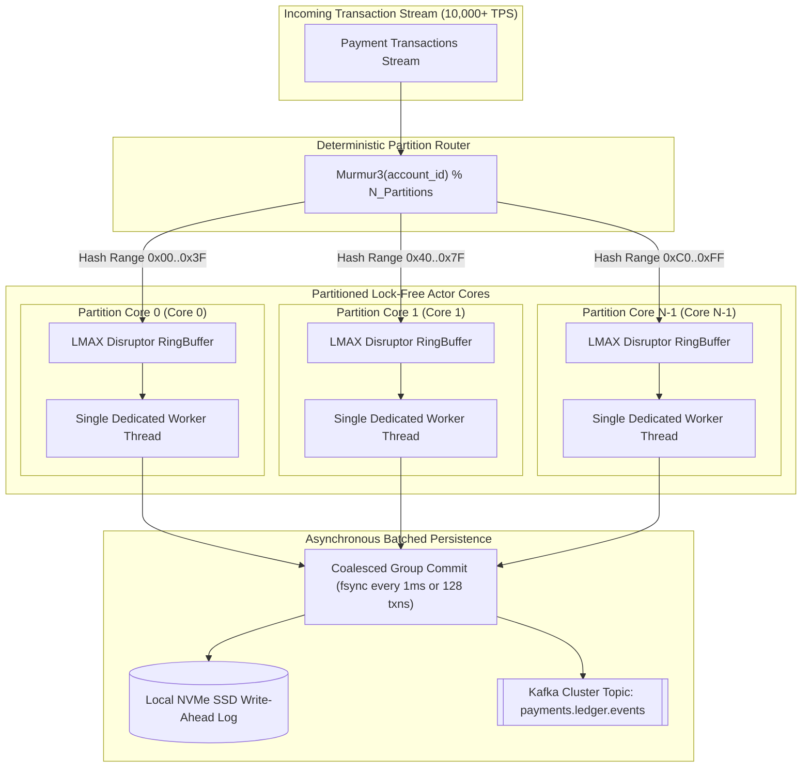
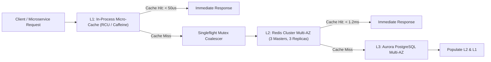

# Low-Latency & High-Throughput Concurrency Architecture

## 1. Executive Summary & Baseline SLA Targets

A payment gateway must satisfy rigorous Service Level Agreements (SLAs) under extreme burst traffic conditions, such as flash sales, payroll disbursement waves, or market settlement windows. Relational database contention on shared merchant or platform clearing accounts presents the primary failure mode in legacy architectures.

The platform establishes the following baseline performance targets, verified continuously under simulated and production loads:

### 1.1 Performance SLA Targets (10,000+ TPS Benchmark)

| Metric | Target Baseline (SLA) | Exceptional (p99 Goal) | Enforcement / Measurement |
| :--- | :--- | :--- | :--- |
| **API Gateway Ingress Latency** | $< 5\text{ms}$ | $< 2\text{ms}$ | Envoy mTLS + HTTP/2 Multiplexing |
| **Internal Ledger Balance Commit** | $< 10\text{ms}$ | $< 3\text{ms}$ | LMAX Disruptor In-Memory Core + Batched NVMe WAL |
| **End-to-End API p50 Latency** | $< 20\text{ms}$ | $< 12\text{ms}$ | OpenTelemetry & Prometheus Histograms |
| **End-to-End API p95 Latency** | $< 50\text{ms}$ | $< 35\text{ms}$ | Automated SLO alerting via Grafana |
| **End-to-End API p99 Latency** | $< 100\text{ms}$ | $< 65\text{ms}$ | PagerDuty incident trigger on breach |
| **Baseline Sustained Throughput**| $2,500\text{ TPS}$ | $5,000\text{ TPS}$ | Validated via distributed load test runners |
| **Peak Burst Throughput** | $10,000+\text{ TPS}$| $15,000\text{ TPS}$ | Elastic node provisioning via Karpenter |

---

## 2. Concurrency Control: The Single-Writer Partitioned Actor Pattern

### 2.1 The Relational Locking Bottleneck (Anti-Pattern)

Under high concurrency, traditional database architectures enforce serial consistency through pessimistic row-level locking:

$$\text{SELECT balance FROM accounts WHERE account\_id = 'PLATFORM\_CLEARING' FOR UPDATE;}$$

When thousands of concurrent transactions attempt to debit or credit the same platform account simultaneously, the database degrades exponentially:
1. **Lock Wait Queues**: Thread wait times escalate from $< 1\text{ms}$ to $> 2,000\text{ms}$.
2. **Connection Pool Exhaustion**: Microservice database pools (e.g., HikariCP, pgx) saturate, causing cascading `ConnectionTimeoutException` failures across the entire service mesh.
3. **Optimistic Locking Retry Storms**: If optimistic concurrency control (CAS: `WHERE version = v`) is utilized, collision rates exceed $90\%$, generating catastrophic retry storms and waste of compute cycles.

### 2.2 LMAX Disruptor & Single-Writer Partitioning

To achieve $> 100,000\text{ TPS}$ per CPU core with sub-millisecond execution, the ledger core implements the **Single-Writer Partitioned Actor Pattern**, inspired by the LMAX Disruptor architecture:



### 2.3 Principles of Mechanical Sympathy in the Ledger Core

1. **Lock-Free Sequential Processing**:
   - Each partition is assigned a dedicated worker thread pinned to an isolated physical CPU core (`pthread_setaffinity_np` or Go runtime affinity).
   - Because exactly one thread writes to an account partition, balance checks and mutations execute in memory with **zero mutual exclusion locks, zero semaphores, and zero CAS loops**.
2. **Elimination of False Sharing & Cache Line Thrashing**:
   - Data structures within the ring buffer are padded with cache-line boundaries ($64\text{ bytes}$) to ensure that adjacent thread operations never invalidate the L1/L2 CPU data cache.
3. **Micro-Batching & Group Commit**:
   - Transactions validated in memory are aggregated into micro-batches (up to 128 entries or $1\text{ms}$ maximum delay).
   - A single sequential I/O write (`pwritev` followed by `fdatasync`) flushes the journal batch to local NVMe storage, achieving $> 150,000\text{ transactions/second}$ per storage controller.

---

## 3. Multi-Tier Caching Architecture & Anti-Stampede Protection



### 3.1 Cache Tier Responsibilities

1. **L1 In-Process Micro-Cache (Read-Copy-Update / Caffeine)**:
   - *Target Latency*: $< 50\text{ microseconds}$.
   - *Cached Assets*: Immutable routing rules, merchant public key certificates, fee schedules, currency precision configurations.
   - *Refresh Policy*: Ultra-short TTL ($2\text{ to }5\text{ seconds}$) with background soft refresh.
2. **L2 Distributed Redis Cluster**:
   - *Target Latency*: $< 1.2\text{ milliseconds}$.
   - *Cached Assets*: Distributed idempotency state tokens, token bucket rate limiting quotas, active merchant balance projections, 3DS challenge state.
   - *Cluster Topology*: 6 nodes (3 Masters, 3 Replicas) striped across 3 Availability Zones with Redis Sentinel/Cluster automated failover.

### 3.2 Cache Anti-Stampede Mitigation

Under high load, when a hot cache entry expires, thousands of concurrent requests can simultaneously miss the cache and overwhelm the underlying database (the "thundering herd" problem). The platform enforces two complementary defenses:

#### 1. Probabilistic Early Expiration (XFetch Algorithm)
Instead of waiting for an explicit TTL expiration, workers probabilistically refresh the cache ahead of expiration based on read frequency and computation time:

$$\Delta t = - \beta \cdot \delta \cdot \ln(rand())$$

Where:
- $\delta$ is the computation time taken to compute/fetch the asset from the database.
- $\beta > 0$ is an aggressiveness multiplier (configured to $1.0$).
- $rand() \sim U(0,1)$ is a uniform pseudo-random number.
- If $(\text{now}() - \Delta t) > (\text{expiry} - \text{TTL})$, an asynchronous background worker triggers a preemptive database fetch, guaranteeing zero cache-miss latency for user requests.

#### 2. Singleflight Request Coalescing
If a cache miss occurs in L1, concurrent worker threads coalesce onto a single inflight request key. Only one thread dispatches the query to Redis or PostgreSQL; all other threads await the result of the single inflight execution.

---

## 4. Message Queuing & Event Streaming Topology

### 4.1 Broker Architecture & Topic Topologies

The transaction streaming backbone is powered by Apache Kafka / Redpanda configured for maximum durability, zero data loss, and linear horizontal scalability.

```
Topic: payments.transaction.lifecycle
Partitions: 64
Replication Factor: 3
min.insync.replicas: 2
acks: all
```

### 4.2 Partitioning & Ordering Guarantees

Transactions are keyed deterministically using **Murmur3**:
$$\text{Partition} = \text{Murmur3}(\text{merchant\_id} \text{ or } \text{account\_id}) \pmod{64}$$

**Guarantees**:
- Strict FIFO event sequencing for any given merchant or financial account.
- Complete horizontal distribution across 64 parallel consumer workers without head-of-line blocking across distinct accounts.

### 4.3 High-Throughput Producer Configuration

```properties
# Durability & Zero Loss Guarantees
acks=all
enable.idempotence=true
max.in.flight.requests.per.connection=5
retries=2147483647

# Batching & Throughput Optimization
compression.type=zstd
linger.ms=5
batch.size=65536
max.request.size=1048576

# Network Buffer Optimization
send.buffer.bytes=1048576
receive.buffer.bytes=1048576
```

### 4.4 Consumer Group Scaling & Fault Isolation

1. **Cooperative Sticky Rebalance (`CooperativeStickyAssignor`)**:
   - Replaces legacy stop-the-world eager rebalance protocols.
   - During rolling Kubernetes deployments or pod scaling, uninterrupted partitions continue consuming without dropping pipeline throughput.
2. **Poison-Pill & Dead-Letter Queue (DLQ) Isolation**:
   - If an unparseable or malicious message triggers repeated consumer exceptions, it is intercepted after 3 retries with exponential backoff.
   - The message is diverted to `payments.transaction.dlq` alongside full diagnostic metadata, exception stack traces, and offset markers.
   - The consumer offset commits immediately, preventing pipeline stalling.
