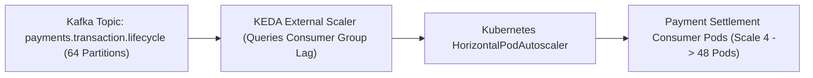
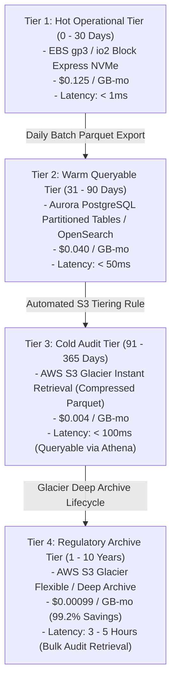

# Compute Sizing, Autoscaling & Storage Lifecycle Tiering

## 1. Executive Summary & Infrastructure Guardrails

In high-throughput financial infrastructure, infrastructure cost runaway is driven by two chronic oversights:
1. **Oversized & Static Compute Provisioning**: Allocating static peak capacity 24/7 or configuring arbitrary CPU/memory request headroom without bin-packing discipline.
2. **Monolithic Storage Retention**: Keeping high-volume transaction audit logs and event streams on expensive high-IOPS NVMe solid-state storage indefinitely.

This specification details the compute right-sizing methodology, event-driven autoscaling via **KEDA (Kubernetes Event-driven Autoscaling)** and **Karpenter**, and an **Automated 4-Tier Storage Lifecycle** yielding sub-millisecond hot operational performance alongside 95% cold storage cost reductions.

---

## 2. Compute Node Sizing & Instance Topology

### 2.1 Graviton3/4 ARM64 Processor Selection

Stateless application microservices (Edge Ingress, Local Remittance, Cross-Border Payout, Payin, and P2P Lending Escrow) are compiled for the **ARM64** architecture and deployed on **AWS Graviton3 (`c7g`)** instances.

| Instance Type | vCPUs | Memory (GB) | Network Bandwidth | EBS Bandwidth | Spot Rate ($/hr) | On-Demand Rate ($/hr) | Role / Service Profile |
| :--- | :--- | :--- | :--- | :--- | :--- | :--- | :--- |
| `c7g.xlarge` | 4 | 8 | Up to 12.5 Gbps | Up to 10 Gbps | $\$0.0440$ | $\$0.1462$ | Worker pods, Webhook Dispatchers |
| `c7g.2xlarge` | 8 | 16 | Up to 15 Gbps | Up to 10 Gbps | $\$0.0880$ | $\$0.2924$ | **Default Application Node Pool** |
| `c7g.4xlarge` | 16 | 32 | Up to 15 Gbps | Up to 10 Gbps | $\$0.1760$ | $\$0.5848$ | High-concurrency LMAX ledger cores |
| `r7g.xlarge` | 4 | 32 | Up to 12.5 Gbps | Up to 10 Gbps | - | $\$0.2660$ | Redis Cache & Stateful In-Memory |

### 2.2 Pod CPU & Memory Bin-Packing Specification

To prevent node fragmentation, every microservice specifies strict resource contracts:

```yaml
resources:
  requests:
    cpu: "250m"
    memory: "512Mi"
  limits:
    cpu: "1000m"
    memory: "1024Mi"
```

A single `c7g.2xlarge` node (7.8 allocatable vCPUs, 14.5 GiB allocatable RAM) hosts up to 28 microservice pods with high bin-packing density ($> 85\%$ resource utilization), avoiding idle hypervisor waste.

---

## 3. Elastic Autoscaling: Karpenter & KEDA

### 3.1 Karpenter Provisioner & NodePool Configuration

Karpenter bypasses the slow Kubernetes Cluster Autoscaler by interfacing directly with the AWS EC2 Fleet API, provisioning customized instances in $< 45\text{ seconds}$ and aggressively consolidating underutilized nodes:

```yaml
apiVersion: karpenter.sh/v1beta1
kind: NodePool
metadata:
  name: payment-core-nodepool
spec:
  template:
    spec:
      requirements:
        - key: "karpenter.k8s.aws/instance-family"
          operator: In
          values: ["c7g", "c7gd"]
        - key: "karpenter.k8s.aws/instance-size"
          operator: In
          values: ["2xlarge", "4xlarge"]
        - key: "kubernetes.io/arch"
          operator: In
          values: ["arm64"]
        - key: "karpenter.sh/capacity-type"
          operator: In
          values: ["on-demand", "spot"]
        - key: "topology.kubernetes.io/zone"
          operator: In
          values: ["ap-southeast-1a", "ap-southeast-1b", "ap-southeast-1c"]
      nodeClassRef:
        name: payment-ec2-nodeclass
  limits:
    cpu: "256"
    memory: "512Gi"
  disruption:
    consolidationPolicy: WhenUnderutilized
    expireAfter: 720h # 30 days rolling refresh
    consolidateAfter: 300s # Reclaim empty/underutilized nodes after 5 minutes
```

### 3.2 KEDA Event-Driven Autoscaling (Queue-Lag Reactive)

Standard CPU-based Horizontal Pod Autoscaling (HPA) fails during asynchronous payment processing bursts because Kafka consumer lag can spike while CPU usage remains low. The platform uses **KEDA** to scale pods directly against Kafka partition consumer lag:



```yaml
apiVersion: keda.sh/v1alpha1
kind: ScaledObject
metadata:
  name: settlement-consumer-scaler
  namespace: payment-core
spec:
  scaleTargetRef:
    name: settlement-worker-deployment
  minReplicaCount: 4
  maxReplicaCount: 48
  pollingInterval: 5
  cooldownPeriod: 30
  triggers:
    - type: kafka
      metadata:
        bootstrapServers: kafka-cluster-kafka-bootstrap.payment-core.svc:9092
        consumerGroup: settlement-engine-group
        topic: payments.transaction.lifecycle
        lagThreshold: "50" # Scale out if average lag per partition exceeds 50 messages
        offsetResetPolicy: latest
```

---

## 4. Multi-Tier Storage Lifecycle & Database Archiving Matrix

Financial regulations mandate storing transaction records for 7 to 10 years, but 99.9% of operational queries target data from the past 30 days.



### 4.1 Storage Tiering Cost & Performance Characteristics

| Storage Tier | Underlying Medium | Retention SLA | Target Data Profile | Cost per GB/Mo | Retrieval Latency |
| :--- | :--- | :--- | :--- | :--- | :--- |
| **Hot Tier** | EBS `gp3` / NVMe SSD | 0 – 30 Days | Active balances, in-flight sagas, live Kafka logs | $\$0.1250$ | $< 1\text{ms}$ |
| **Warm Tier** | Aurora Table Partitions | 31 – 90 Days | Settled transactions, recent merchant dashboard queries | $\$0.0400$ | $< 50\text{ms}$ |
| **Cold Tier** | S3 Glacier Instant | 91 – 365 Days | Monthly tax statements, compliance logs, dispute evidence | $\$0.0040$ | $< 100\text{ms}$ |
| **Archive Tier**| S3 Glacier Deep Archive | 1 – 10 Years | Regulatory audit trails (PCI-DSS §10, AML 7-yr retention) | **$\$0.00099$** | $3 - 5\text{ Hours}$ |

---

## 5. Parquet Columnar Compression & Serverless Athena Querying

### 5.1 Columnar Compression Optimization

Raw transaction JSON payloads ($2\text{ KB}$ average size) are extracted daily from PostgreSQL and converted into **Apache Parquet format with Zstandard (`zstd`) compression**:

$$\text{Raw JSON Volume (100M Txns)} = 100,000,000 \times 2\text{ KB} = 200\text{ GB}$$
$$\text{Parquet + Zstandard Volume} = 36\text{ GB} \quad \mathbf{(82\%\text{ Storage Footprint Reduction})}$$

### 5.2 Serverless S3 Querying via AWS Athena / Trino

Historical ledger data in S3 is partitioned hierarchically by date:
```text
s3://payment-ledger-cold-archive/year=2026/month=11/day=10/corridor=USD-IDR/data.parquet
```

Auditors and dispute investigators query petabytes of cold data using standard ANSI SQL without hydrating databases:

```sql
SELECT transaction_id, merchant_id, amount, status
FROM "payment_cold_lake"."transactions"
WHERE year = '2026' 
  AND month = '11' 
  AND day = '10'
  AND merchant_id = 'merchant_enterprise_01';
```

**Cost Efficiency**: Partition pruning restricts data scanning strictly to the target day's directory. A query searching across 100 million transactions scans only $36\text{ GB}$, costing **less than $\$0.18$** under AWS Athena's $\$5.00/\text{TB}$ model.
