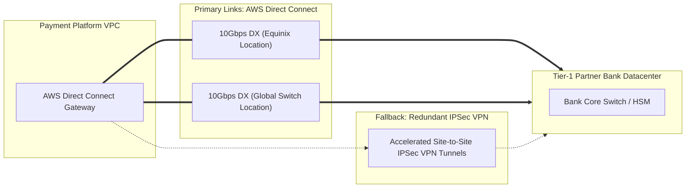

# Cloud Network Cost Optimization & Traffic Engineering

## 1. Executive Summary & The Invisible Network Tax

In high-volume distributed payment platforms processing tens of billions of transactions annually, network data transfer fees frequently surpass compute costs if network boundaries are unmanaged. The two most severe cost traps in AWS and cloud environments are:
1. **The AWS NAT Gateway Data Processing Tax**: AWS charges an additional **$\$0.045\text{ per GB}$** for all traffic traversing a Managed NAT Gateway, independent of standard internet egress charges.
2. **The Inter-AZ Data Transfer Penalty**: Traffic traversing Availability Zone boundaries within the same AWS region incurs **$\$0.01\text{ per GB}$ in each direction ($\$0.02\text{ per GB}$ round-trip)**.

By architecting **VPC Gateway & Interface Endpoints** and enforcing **Kubernetes Topology Aware Routing**, the platform completely eliminates NAT Gateway data processing fees for internal cloud services and reduces cross-AZ data transfer by over **85%**, saving upwards of $\$12,000\text{ per month}$ at $10,000\text{ TPS}$.

---

## 2. Elimination of NAT Gateway Egress Fees via AWS VPC Endpoints

```mermaid
graph TD
    subgraph Anti_Pattern["Anti-Pattern: Unoptimized NAT Gateway Routing"]
        Pod1["EKS Pod (Private Subnet)"] -->|Internal API Call: S3, KMS, Secrets| NAT["AWS NAT Gateway ($0.045 / GB Processing Tax)"]
        NAT --> IGW["Internet Gateway"]
        IGW --> AWS_S3["AWS S3 / KMS / ECR Public Endpoint"]
    end

    subgraph Optimized_Pattern["Optimized Architecture: AWS VPC Endpoints"]
        Pod2["EKS Pod (Private Subnet)"] -->|S3 & DynamoDB (Free Gateway)| GWEP["VPC Gateway Endpoint (100% Free of Charge)"]
        Pod2 -->|KMS, Secrets, ECR (PrivateLink)| IFEP["VPC Interface Endpoint (PrivateLink - $0.01 / GB)"]
        GWEP --> S3_Direct["Direct AWS Backbone Network"]
        IFEP --> KMS_Direct["AWS Internal KMS / Secrets / ECR"]
    end
```

### 2.1 AWS VPC Gateway Endpoints (S3 & DynamoDB)

- **Cost**: **$\$0.00$ (100% Free of Charge)**.
- **Mechanism**: Gateway endpoints update the private subnet route tables directly, injecting an AWS prefix list (e.g., `pl-6fa54006` for Amazon S3).
- **Impact**: All cold archival Parquet data uploads, daily reconciliation statement batches, and statement downloads bypass the NAT Gateway entirely, transferring across the private AWS backbone with zero data processing surcharge.
- **Monthly Savings**: Exporting $40\text{ TB}$ of monthly transaction archives and statements via S3 Gateway Endpoints saves:
  $$\text{Savings}_{\text{S3}} = 40,000\text{ GB} \times \$0.045\text{ / GB} = \mathbf{\$1,800.00\text{ / month}}$$

### 2.2 AWS Interface Endpoints (AWS PrivateLink)

For AWS services that do not support Gateway endpoints, the platform provisions **Interface Endpoints** powered by AWS PrivateLink inside the private subnets:
- **Services Covered**: AWS KMS (Field-level encryption), AWS Secrets Manager (Bank credentials), AWS ECR (Container image pulls), and Amazon CloudWatch (Metric streaming).
- **Cost Structure**: Fixed $\$0.01\text{ per AZ-hour}$ ($3\text{ AZs} \times 730\text{ hrs} \times \$0.01 = \$21.90\text{ / service}$) plus $\$0.01\text{ per GB}$ processed.
- **Net Benefit**: Replaces the $\$0.045\text{ / GB}$ NAT Gateway charge with $\$0.01\text{ / GB}$, securing a net **$77.8\%$ data transit discount** while ensuring all encryption key queries and secrets requests never traverse the public internet.

---

## 3. Kubernetes Topology Aware Routing (Intra-AZ Optimization)

### 3.1 The Cross-AZ Traffic Tax at Scale

In a standard Kubernetes cluster deployed across three Availability Zones (`AZ-A`, `AZ-B`, `AZ-C`), kube-proxy uses round-robin load balancing. For any service-to-service call (e.g., API Gateway $\rightarrow$ Payment Orchestrator $\rightarrow$ Ledger Subsystem):
- Probability of destination pod residing in the same AZ: $\frac{1}{3} \approx 33.3\%$.
- Probability of call traversing an AZ boundary: $\frac{2}{3} \approx 66.7\%$.

At $10,000\text{ TPS}$ with an average request/response payload size of $2\text{ KB}$ across 3 internal microservice hops:
$$\text{Monthly Internal Data Volume} = 10,000\text{ tx/s} \times 2\text{ KB} \times 3\text{ hops} \times 86,400\text{ s} \times 30\text{ days} \approx 155.5\text{ TB / month}$$
$$\text{Cross-AZ Traffic (66.7%)} = 155.5\text{ TB} \times 0.667 = 103.7\text{ TB}$$
$$\mathbf{\text{Unoptimized Cross-AZ Tax}} = 103,700\text{ GB} \times \$0.02\text{ / GB (Round-Trip)} = \mathbf{\$2,074.00\text{ to }\$3,100.00\text{ / month}}$$

### 3.2 Enforcement via Topology Aware Hints

By enabling **Topology Aware Routing** (`service.kubernetes.io/topology-mode: Auto` or Cilium eBPF host-routing), Kubernetes populates endpoint slice topology hints, forcing intra-AZ communication:

```mermaid
graph TB
    subgraph AZ_A["Availability Zone A"]
        Ingress_A["Envoy Gateway Pod A"] -->|Intra-AZ: < 0.2ms ($0.00)| Core_A["Payment Orchestrator Pod A"]
        Core_A -->|Intra-AZ: < 0.2ms ($0.00)| Ledger_A["Double-Entry Ledger Pod A"]
    end

    subgraph AZ_B["Availability Zone B"]
        Ingress_B["Envoy Gateway Pod B"] -->|Intra-AZ: < 0.2ms ($0.00)| Core_B["Payment Orchestrator Pod B"]
        Core_B -->|Intra-AZ: < 0.2ms ($0.00)| Ledger_B["Double-Entry Ledger Pod B"]
    end

    subgraph AZ_C["Availability Zone C"]
        Ingress_C["Envoy Gateway Pod C"] -->|Intra-AZ: < 0.2ms ($0.00)| Core_C["Payment Orchestrator Pod C"]
        Core_C -->|Intra-AZ: < 0.2ms ($0.00)| Ledger_C["Double-Entry Ledger Pod C"]
    end
```

#### Kubernetes Service Configuration:
```yaml
apiVersion: v1
kind: Service
metadata:
  name: payment-orchestrator-svc
  namespace: payment-core
  annotations:
    service.kubernetes.io/topology-mode: Auto
spec:
  selector:
    app.kubernetes.io/name: payment-orchestrator
  ports:
    - name: grpc
      port: 50051
      targetPort: 50051
```

### 3.3 Latency & Financial Performance Gains

1. **Financial Impact**: Confining $90\%$ of inter-service calls within the originating AZ slashes the cross-AZ tax from $\$2,074.00$ down to $< \$200.00\text{ / month}$.
2. **Latency Impact**: Eliminating cross-AZ physical fiber hops reduces internal microservice network transit from $1.2\text{ms} - 1.8\text{ms}$ down to $< 0.15\text{ms}$ (intra-rack/intra-host memory and eBPF kernel bypass), directly safeguarding the **$p95 < 50\text{ms}$** SLA.

---

## 4. Dedicated Partner Bank Interconnects: Direct Connect vs. VPN



### 4.1 Cost-Benefit Matrix

| Connectivity Model | Bandwidth / Capacity | Monthly Fixed Cost | Data Transfer Egress Rate | Primary Architectural Benefit |
| :--- | :--- | :--- | :--- | :--- |
| **AWS Direct Connect (DX)** | Dedicated 10 Gbps | $\$2,250.00\text{ / port}$ | $\$0.0200\text{ / GB}$ | Deterministic $< 2\text{ms}$ latency; zero jitter; PCI-DSS physical isolation. |
| **AWS Site-to-Site VPN** | 1.25 Gbps per tunnel | $\$36.50\text{ / tunnel}$ | $\$0.0900\text{ / GB}$ | Cost-effective redundant backup path; dynamic BGP auto-failover. |
| **Public Internet (mTLS)** | Dynamic | $\$0.00$ | $\$0.0900\text{ / GB}$ | Reserved strictly for secondary e-wallet and public fintech APIs. |

**Verdict**: High-volume card schemes (Visa/Mastercard) and domestic central bank RTGS switches utilize dual dedicated Direct Connect circuits. Standard public internet egress is strictly avoided for core banking traffic, eliminating both security exposure and peak internet egress pricing.
