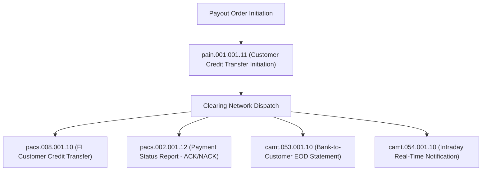
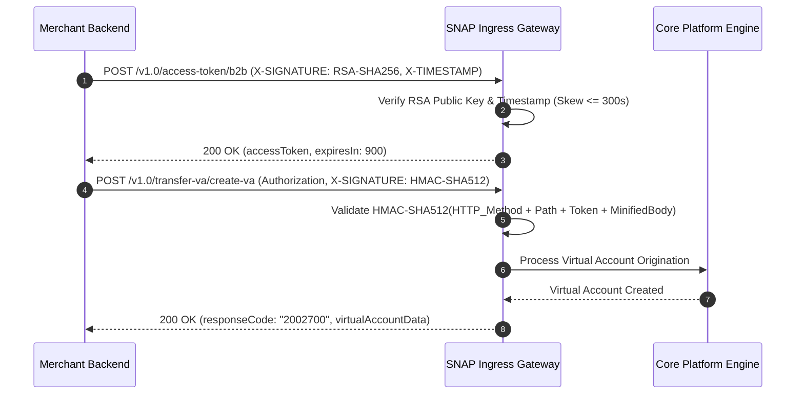
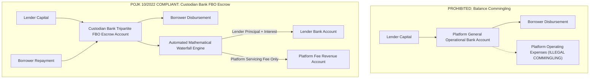

# Regulatory Compliance Mapping & Financial Standards Certification

## 1. Executive Summary & Regulatory Framework

As an enterprise payment gateway and financial clearing infrastructure, the platform must operate in strict compliance with international security standards and regional central bank regulatory mandates. This specification documents the explicit architectural mappings and technical controls satisfying:

1. **PCI-DSS v4.0 Level 1** (Payment Card Industry Data Security Standard)
2. **ISO 20022 Financial Messaging Standard** (Universal Financial Industry Message Scheme)
3. **Bank Indonesia SNAP (Standar Nasional Open API Pembayaran) & BSPI 2030** (Blueprint Sistem Pembayaran Indonesia)
4. **OJK Regulation POJK 10/POJK.05/2022** (Information Technology-Based Co-Financing Services & Trust Escrow)

---

## 2. PCI-DSS v4.0 Level 1 Technical Controls & Scoping

The platform achieves minimal Cardholder Data Environment (CDE) audit scope by enforcing **Edge Tokenization**:

```mermaid
graph LR
    Cardholder["Cardholder Browser / App"] -->|Encrypted TLS 1.3| EdgeIngress["Envoy API Gateway (Perimeter Edge)"]
    EdgeIngress -->|Plaintext PAN (Isolated Vault Only)| TokenVault["PCI-DSS Vault / HSM (Tokenization Engine)"]
    TokenVault -->|Store Encrypted PAN (AES-256-GCM)| VaultDB[("HSM Encrypted Vault DB")]
    TokenVault -->|Return Ephemeral Token: tok_99ab12| EdgeIngress
    EdgeIngress -->|Tokenized Payload: tok_99ab12| CoreApps["Payment Gateway Core Microservices"]
    CoreApps -->|Store Tokenized Leg| LedgerDB[("Double-Entry Ledger (Out of CDE Scope)")]
```

### 2.1 PCI-DSS v4.0 Requirement Mapping Matrix

| PCI-DSS v4.0 Req | Requirement Summary | Platform Technical Implementation | Architectural Evidence & Verification |
| :--- | :--- | :--- | :--- |
| **Req 3.2** | Do not store sensitive authentication data (SAD) after authorization. | Card Verification Value (CVV/CVC) and magnetic stripe data are processed transiently in volatile memory during authorization and never written to persistent disk or logs. | Envoy log masking filters and database trigger constraints reject SAD ingestion. |
| **Req 3.4** | Protect Primary Account Number (PAN) wherever stored. | PANs are tokenized at the perimeter edge. Stored records inside the isolated PCI vault use AES-256-GCM with customer-managed keys rotated annually via AWS KMS HSM. | Core ledger database contains only surrogate tokens (`token_id`), completely descope from CDE storage requirements. |
| **Req 4.1** | Protect cardholder data with strong cryptography during transmission. | TLS 1.3 enforced on all perimeter endpoints with modern cipher suites (`TLS_AES_256_GCM_SHA384`, `TLS_CHACHA20_POLY1305_SHA256`). Internal microservices communicate via mutual TLS (mTLS). | Ingress Envoy reject ciphers $< \text{TLS 1.3}$; mTLS enforced via Linkerd service mesh. |
| **Req 8.3** | Strong multi-factor authentication (MFA) and access control. | All merchant API interactions require cryptographic HMAC signatures or OAuth2 mTLS client assertions. Cloud console access requires FIDO2 WebAuthn hardware security keys. | API Gateway signature validation filters; AWS IAM IdP federation. |
| **Req 10.2** | Audit trails for all access to cardholder data and financial balances. | Immutable append-only audit logging streaming to Amazon S3 Object Lock (WORM - Write Once, Read Many) with SHA-256 tamper-evident hash chaining. | Verified via `test_f25_01_tamper_evident_journal_hash_chain`. |

---

## 3. ISO 20022 Financial Messaging Mapping

The platform standardizes on ISO 20022 XML/JSON schemas for all interbank communications, cross-border remittances, and automated clearing:



### 3.1 ISO 20022 Message Specifications

1. **`pacs.008.001.10` (Financial Institutional Customer Credit Transfer)**:
   - Used for executing domestic RTGS/ACH transfers and cross-border disbursements.
   - Core elements: `<GrpHdr>`, `<EndToEndId>` (Maps to `payout_order_id`), `<IntrBkSttlmAmt>` (Normalized minor units), `<DbtrAgt>`, `<CdtrAgt>`.
2. **`pacs.002.001.12` (Payment Status Report)**:
   - Synchronous or asynchronous response from the clearing house.
   - Transaction status codes: `ACTC` (Accepted Technical Validation), `ACCP` (Accepted Customer Profile), `ACSC` (Accepted Settlement Completed), `RJCT` (Rejected).
3. **`camt.053.001.10` (Bank-to-Customer Statement)**:
   - End-of-day electronic statement consumed by the Automated 3-Way Reconciliation Engine.
4. **`camt.054.001.10` (Debit/Credit Notification)**:
   - Real-time push notification from clearing banks confirming instant settlement into the platform Nostro account.

---

## 4. Bank Indonesia SNAP & BSPI 2030 Open Banking Standards

To operate legally within Indonesia and Southeast Asian clearing networks under **Bank Indonesia Regulation No. 23/15/PBI/2021** and the **BSPI 2030** vision, the platform complies with **SNAP Open API (Standar Nasional Open API Pembayaran)**:



### 4.1 SNAP Security Protocol Implementation

1. **Asymmetric Signature (`X-SIGNATURE` for B2B Token Acquisition)**:
   - Signature algorithm: `SHA256withRSA` (2048-bit key) or `SHA256withECDSA` (P-256 curve).
   - String to sign: `client_id + "|" + X-TIMESTAMP`.
2. **Symmetric Signature (`X-SIGNATURE` for Transaction Requests)**:
   - Signature algorithm: `HMAC-SHA512` using the client secret.
   - String to sign:
     $$\text{String2Sign} = \text{HTTP\_Method} + ":" + \text{Path} + ":" + \text{AccessToken} + ":" + \text{SHA256}(\text{MinifiedBody}) + ":" + \text{X-TIMESTAMP}$$
3. **Standardized SNAP Response Codes**:
   - `2002700`: Successful Virtual Account / Transfer creation.
   - `4007300`: Invalid Amount or Currency mismatch.
   - `4017300`: Unauthorized / Invalid Signature.
   - `4097300`: Duplicate Transaction / Idempotency Conflict.

---

## 5. OJK POJK 10/POJK.05/2022 P2P Lending Escrow Compliance

Under Indonesian Financial Services Authority (OJK) regulations for P2P lending platforms, client funds (lender capital and borrower repayments) must never touch the platform's operational accounts.



### 5.1 Technical Controls for OJK Trust Escrow Compliance

1. **Custodian Bank FBO (For Benefit Of) Trust Account Isolation**:
   - Capital is deposited directly into a legally segregated tripartite FBO escrow account registered under a licensed custodian bank (e.g. Bank Mandiri, BCA, or BRI).
   - The platform acts solely as an authorized instructional agent; funds are legally owned by the registered lenders and borrowers.
2. **Zero Balance Commingling**:
   - The double-entry ledger enforces strict chart of accounts separation. The Escrow FBO Liability Account (`230100 - P2P Lending Escrow`) is partitioned from Platform Capital (`320000`) and Operational Revenue (`410000`).
   - SQL check constraints prevent transferring funds between escrow liability accounts and general expense accounts.
3. **Automated Mathematical Waterfall Execution**:
   - Loan repayment collections are distributed deterministically according to the agreed priority queue:
     $$\text{Principal Repayment} \rightarrow \text{Contractual Interest} \rightarrow \text{Overdue Penalty} \rightarrow \text{Tax Withholding} \rightarrow \text{Platform Fee}$$
   - Every fractional distribution generates a cryptographically signed statement provided to both the lender and the OJK regulatory reporting portal.
